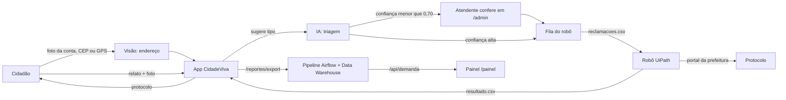
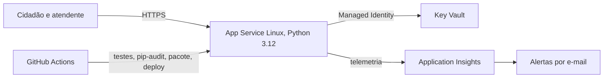

# CidadeViva

**Reportou. Foi protocolado.** Plataforma de zeladoria urbana colaborativa: o cidadão reporta um problema da rua, a IA sugere o tipo, uma pessoa confere quando há dúvida, e um robô registra no portal legado da prefeitura e devolve o protocolo.

Global Solution FIAP 2026.2 · CitizenTech · Engenharia de Software, 4º ano · Equipe CitizenTech

| Integrante | RM |
|---|---|
| Giovanna Franco Gaudino Rodrigues | RM553701 |
| Rafael de Almeida Sigoli | RM554019 |
| Rafael Jorge Del Padre | RM552765 |

## Links

| | |
|---|---|
| **MVP no ar** | https://citizentech-girafas.azurewebsites.net |
| **Repositório principal** | https://github.com/girafasfiap-cyber/GS_CitizenTech_MVP_Startup |
| **Página de apresentação** | https://girafasfiap-cyber.github.io/GS_CitizenTech_MVP_Startup/ |
| **Vídeo do pitch** | _(link a incluir)_ |
| **Pitch e modelo de negócio (PDF)** | [docs/CidadeViva_Startup_Pitch_MVP.pdf](docs/CidadeViva_Startup_Pitch_MVP.pdf) |

## Ir direto para a sua disciplina

Um MVP único atravessa as sete disciplinas. Cada seção abaixo se lê sozinha e diz o que avaliar, onde está no código e como verificar.

| Disciplina | Seção |
|---|---|
| Secure DevOps Tools & Cloud Computing | [Cloud e Secure DevOps](#cloud) |
| Business Intelligence & Startup Development | [Startup e modelo de negócio](#startup) |
| Applied Computer Vision | [Visão Computacional](#visao) |
| Generative AI for Engineering | [IA Generativa](#genai) |
| Robotic Process Automation | [RPA](#rpa) |
| Big Data Architecture & Data Integration | [Big Data](#bigdata) |
| Project-Based Maker Lab | [Peça física](#maker) |

## Ficha Técnica do MVP

| Campo | CidadeViva |
|---|---|
| Nome do produto | CidadeViva |
| Cidadão e território | Moradores de cidades brasileiras que veem buracos, bueiros entupidos, calçadas quebradas e lixo. Cliente pagante: a prefeitura. Dados reais de São Paulo (SP156). |
| Problema, em uma frase | O cidadão reporta e não recebe resposta, e a prefeitura redigita cada reclamação em portais legados sem API. |
| Proposta de valor | Reporte em 3 passos, com endereço lido da conta de luz, água ou telefone, código de acompanhamento e protocolo da prefeitura. |
| Arquitetura: componentes | App web (Starlette) + Visão (OCR) + triagem por IA + ponte RPA (UiPath) + pipeline de dados (Airflow) + Azure App Service com CI/CD. |
| Fontes de dados | SP156, da Prefeitura de São Paulo (real, CC0); reportes do app; faturas sintéticas para teste de Visão. |
| Modelos de IA | Tesseract + OpenCV (Visão); LLM via OpenRouter (componente de IA Generativa em `app/genai`) com reserva por regras lexicais (triagem e redação). |
| URL do MVP e repositório | Ver tabela de links acima. |
| Indicadores de impacto | Tempo até o protocolo; % de reportes com protocolo; horas de digitação evitadas; % de revisão humana da IA; resolução por subprefeitura. |
| ODS conectados | ODS 11 (cidades e comunidades sustentáveis), ODS 9 (inovação e infraestrutura), ODS 10 (redução das desigualdades). |

### As seis perguntas do briefing

1. **Quem é o cidadão beneficiado?** Quem reporta um problema da rua com celular de entrada, e o atendente da prefeitura que hoje redigita cada caso.
2. **Qual problema será resolvido?** Reclamações que se perdem, sem protocolo nem retorno, e digitação manual em portal legado (cerca de 6 min por caso, com 8% de erro estimado).
3. **Como a solução funcionará?** Veja o fluxo abaixo e a seção [Teste em 5 minutos](#teste).
4. **Quais tecnologias?** Python/Starlette, OpenCV e Tesseract, LLM (OpenRouter), UiPath, Airflow, Azure App Service, GitHub Actions, Application Insights.
5. **Quem participa do ecossistema?** Cidadão, atendente, gestor municipal, prefeitura (portal legado) e concessionárias cujas contas servem de comprovante de endereço (Enel, Sabesp, Claro).
6. **Como medir e ampliar o impacto?** Indicadores acima; a escala vem de configurar o robô para o portal de cada novo município e reaproveitar o mesmo app e o mesmo pipeline.

## Como funciona



Status do reporte: `novo → triado → enviado_prefeitura → resolvido` (os mesmos nomes do pipeline de dados).

<a id="teste"></a>
## Teste em 5 minutos

1. Abra o MVP, reporte com o CEP `01310-100` (a rua, o bairro e a cidade são preenchidos) e descreva "buraco grande na rua". Anote o código `CV-…`.
2. Opcional: no passo 1, abra "Leia o endereço da minha conta" e envie uma foto da pasta `tests/fixtures/` (por exemplo `sabesp_000.jpg`). Confira o endereço na tela de conferência.
3. Em `/admin`, entre com a chave do atendente (enviada junto com a entrega), aprove o reporte e baixe o `reclamacoes.csv`.
4. Rode o robô com esse arquivo e envie o `reclamacoes_resultado.csv` de volta em `/admin`.
5. Consulte o código na página inicial: o protocolo aparece. Veja também `/painel` e `/health`.

## Rotas principais

| Rota | Uso | Acesso |
|---|---|---|
| `GET /`, `/painel`, `/admin` | Páginas do cidadão, do painel e do atendente | público (admin pede chave nas chamadas) |
| `POST /extract-address` | Visão: foto da conta → endereço | público, com limite por IP |
| `POST /api/triagem` | IA: sugere categoria e texto formal | público, com limite por IP |
| `GET /api/cep/{cep}`, `GET /api/geocode` | Endereço por CEP (ViaCEP) e por GPS (OpenStreetMap) | público |
| `POST /api/reportes`, `GET /api/reportes/{codigo}` | Criar e acompanhar um reporte | público |
| `GET /api/admin/reportes`, `POST /api/admin/reportes/{codigo}/aprovar` | Fila do atendente | chave `X-API-Key` |
| `GET /rpa/fila.csv`, `POST /rpa/resultado` | Contrato com o robô | chave `X-API-Key` |
| `GET /reportes/export` | Contrato com o pipeline de dados | chave `X-API-Key` |
| `GET /api/stats`, `GET /api/demanda` | Dados do painel | público |
| `GET /health` | Verificação de saúde e versão | público |

<a id="cloud"></a>
## Cloud e Secure DevOps

**Disciplina:** Secure DevOps Tools & Cloud Computing · **Atividade:** CitizenTech no Ar

**O que foi entregue:** o MVP completo em URL pública com HTTPS, deploy automático a cada commit, segredos fora do código, acesso por papel e monitoramento com alerta.

| Item | Como está |
|---|---|
| URL pública | https://citizentech-girafas.azurewebsites.net (Azure App Service, Linux, B1, East US 2) |
| Grupo de recursos | `rg-citizentech`, plano `plan-citizentech` |
| HTTPS e plataforma | HTTPS obrigatório, TLS mínimo 1.2, FTP desativado, verificação de saúde em `/health` |
| CI/CD | GitHub Actions: `.github/workflows/ci-cd.yml` |
| Segredos | Variáveis do App Service e segredos do GitHub; nenhum segredo no código; `.env` e perfis de publicação fora do Git |
| Acesso por papel | Cidadão (público), atendente e robô (chave `X-API-Key`; sem a chave configurada a rota responde 503) e Azure RBAC (papel Contribuinte no grupo de recursos) |
| Monitoramento | Application Insights (`ai-citizentech`), alertas por e-mail e teste de disponibilidade em `/health` |
| Análise de segurança | CodeQL (`.github/workflows/codeql.yml`), `pip-audit` no pipeline e Dependabot |
| Infraestrutura como código | `infra/setup-azure.sh` (Azure CLI) |

### Arquitetura em produção



### Pipeline (CI/CD)

1. **`build-test`:** instala o Tesseract e as dependências, roda os 21 testes (`pytest`), a auditoria de dependências (`pip-audit`) e empacota o app.
2. **`deploy`** (só na `main`, depois do `build-test`): publica o pacote no App Service com `azure/webapps-deploy` e roda um *smoke test* em `/health`.
3. Pull requests rodam apenas o `build-test`. O CodeQL roda em paralelo.

### Configuração do App Service

| Onde | Nome | Valor |
|---|---|---|
| Definições de pilha | Comando de arranque | `apt-get update -qq && apt-get install -y -qq tesseract-ocr tesseract-ocr-por libglib2.0-0 && python -m uvicorn app.main:app --host 0.0.0.0 --port 8000 --proxy-headers --forwarded-allow-ips='*'` |
| Variáveis de ambiente | `SCM_DO_BUILD_DURING_DEPLOYMENT` | `true` (o Azure instala as dependências no deploy) |
| Variáveis de ambiente | `WEBSITES_CONTAINER_START_TIME_LIMIT` | `600` (a primeira partida instala o Tesseract) |
| Variáveis de ambiente | `DATA_DIR` | `/home/data` (pasta que persiste entre reinícios) |
| Variáveis de ambiente | `ADMIN_KEY` | chave longa e aleatória (atendente, robô e pipeline) |
| Variáveis de ambiente | `APPLICATIONINSIGHTS_CONNECTION_STRING` | criada pelo `infra/setup-azure.sh`; liga a telemetria |
| Variáveis de ambiente | `OPENROUTER_API_KEY` (opcional) | sem ela a triagem usa as regras de reserva |

O Tesseract é instalado na partida porque o App Service com runtime Python não o traz. Por isso a primeira partida leva alguns minutos.

### Como publicar

1. Crie os recursos com `infra/setup-azure.sh` (ou pelo portal) e configure o App Service como na tabela acima.
2. No GitHub, em *Settings → Secrets and variables → Actions*, crie `AZURE_APP_NAME` (nome do App Service) e `AZURE_PUBLISH_PROFILE` (conteúdo do perfil de publicação baixado no portal).
3. Faça push na `main` e acompanhe a aba *Actions*. Confira `/health`.

### Custo estimado

Cerca de US$ 13,94 por mês (aproximadamente US$ 167 por ano), quase tudo do plano B1 do App Service. O Application Insights e o Key Vault ficam dentro do uso gratuito ou de centavos neste volume. Valores conforme o calculador de preços do Azure na data da entrega.

### Limitações conhecidas

- A autenticação básica do SCM fica habilitada porque o deploy usa o perfil de publicação. A melhoria é migrar para OIDC (`azure/login`).
- Banco SQLite num único app: não escala horizontalmente. O próximo passo seria Azure Database for PostgreSQL.
- O login do atendente é uma chave única, e não contas individuais.

<a id="startup"></a>
## Startup e modelo de negócio

**Disciplina:** Business Intelligence & Startup Development · Detalhes completos no [PDF do pitch](docs/CidadeViva_Startup_Pitch_MVP.pdf).

- **Quem paga:** a prefeitura; o cidadão não paga.
- **Planos (hipóteses de preço do grupo):** Essencial, R$ 2.900 por mês (50 a 100 mil habitantes); Completo, R$ 6.900 por mês (100 a 500 mil habitantes).
- **Por que cabe no orçamento:** o Essencial custa R$ 34.800 por ano, abaixo do limite de dispensa de licitação de 2026 (R$ 65.492,11, Decreto nº 12.807/2025).
- **Mercado (IBGE, Censo 2022):** 337 municípios de 50 a 100 mil habitantes e 278 de 100 a 500 mil, o que dá um teto teórico de R$ 34,7 milhões por ano; mais 41 municípios acima de 500 mil.
- **Evidência de demanda:** o SP156 de 2026 tem 472.524 solicitações de zeladoria só nas 7 categorias que o produto cobre, e 17% (81.193) seguem abertas ou em andamento.
- **Projeção do grupo:** 3, 10 e 30 municípios nos anos 1, 2 e 3; resultado mensal positivo no mês 23. São estimativas, com premissas e riscos descritos no PDF.

<a id="visao"></a>
## Visão Computacional

**Disciplina:** Applied Computer Vision · Repositório original do componente: https://github.com/delpadre/CidadeViva-ComputerVision

**O que faz:** recebe a foto de uma conta de luz, água ou telefone (Enel, Sabesp, Claro), corrige a perspectiva, aplica OCR e devolve o **endereço do imóvel**, distinguindo-o do endereço de cobrança e da sede da empresa.

**Onde está:** pasta `citizen_vision/` (biblioteca) exposta por `POST /extract-address` em `app/main.py`; a tela de conferência está em `static/index.html`.

**Pipeline:** foto → localizar a folha e a perspectiva → pré-processamento (sombra, ruído, inclinação) → OCR por linhas → identificar a empresa → achar o rótulo do endereço certo → extrair os campos → validar (CEP, UF, CEP × cidade).

**Integração com o MVP:** o resultado abre a tela "Confira o endereço da conta", com os campos duvidosos destacados. O cidadão confirma ou corrige, e o endereço segue no reporte marcado como `foto_fatura`. Se a leitura falhar, o cidadão digita. A foto da conta é processada em memória e nunca é guardada.

**Evidências (90 faturas sintéticas):** 98,9% dos endereços 100% corretos, sem falhas silenciosas, cerca de 2,2 s por foto; 97,8% com a foto reduzida a 2000 px, como a página envia.

**Como verificar:** `python -m pytest -q tests` (inclui contas de teste em `tests/fixtures/`) ou envie uma delas no passo 1 do MVP.

<a id="genai"></a>
## IA Generativa

**Disciplina:** Generative AI for Engineering

**Repositório original do componente:** https://github.com/RafaelDevProjects/cidadeviva-ai (53 testes, evidências com modelo real e casos de borda).

**O que faz:** `app/triagem.py` classifica o relato do cidadão em uma das 7 categorias do SP156 (pavimento, iluminação, limpeza urbana, árvores e áreas verdes, calçadas e acessibilidade, sinalização e semáforos, drenagem) e redige o texto formal que o robô envia à prefeitura. Além da categoria, o componente devolve prioridade, risco imediato, órgão responsável e dados que faltam.

**Como entra no MVP:** o código do componente está em `app/genai/` (prompt versionado com exemplos, saída JSON validada por schema, até 2 reparos, fallback de modelo, guardrails e resposta segura). `app/triagem.py` o chama e traduz a taxonomia dele para as categorias do banco (`MAPA_GENAI`); categorias sem equivalente (água e esgoto, estrada rural, outro) vão para revisão humana. O mesmo código roda em `POST /api/triagem` e, de novo, ao gravar o reporte em `POST /api/reportes` (a segunda chamada sai do cache).

**Como decide:** com `OPENROUTER_API_KEY`, usa o componente de IA Generativa via OpenRouter (modelo em `OPENROUTER_MODEL`). Sem a chave, se a IA passar de `LLM_TIMEOUT` segundos (padrão 15) ou se devolver a resposta de contingência, usa regras lexicais (`regras-v1`). A resposta sempre traz categoria, confiança e modelo usado.

**IA responsável:**
- A descrição do cidadão é tratada como dado, e não como instrução: delimitadores no prompt e regra explícita contra injeção.
- A saída é validada por schema e contra a lista fixa de categorias.
- CPF, telefone e e-mail são mascarados antes de qualquer texto sair para o LLM.
- A prioridade depende de risco e impacto, e o prompt proíbe usar bairro, renda ou perfil.
- **Pessoa no circuito:** confiança abaixo de 0,70 (`LIMIAR_CONFIANCA_IA`), categoria sem equivalente ou revisão pedida pela IA mandam o reporte para o atendente antes do envio à prefeitura. A IA nunca bloqueia o reporte do cidadão.
- Limitação: usamos modelos gratuitos, a confiança que o modelo declara não é calibrada, e não medimos viés por região.
- **Privacidade com modelos gratuitos:** os provedores gratuitos do OpenRouter podem guardar e usar os textos enviados para treinar modelos. Por isso só vai para o LLM o texto da descrição, sem identificador do usuário, e CPF, telefone e e-mail são mascarados antes. Nomes e endereços escritos livremente no relato não são mascarados. Em produção, a prefeitura deve usar um modelo pago com contrato de não retenção e não treinamento, ou um modelo hospedado por ela, antes de tratar dados reais.

**Como verificar:** descreva "buraco grande no meio da rua" e veja a sugestão automática; descreva algo vago ("tem um problema aí") e veja o aviso de revisão.

<a id="rpa"></a>
## RPA

**Disciplina:** Robotic Process Automation

**O que faz:** o robô UiPath lê a fila de reclamações aprovadas, preenche o portal da prefeitura (que não tem API) e devolve o protocolo. Cada reclamação roda em um bloco Try/Catch: se o portal rejeita um caso, o robô registra a falha e segue para o próximo.

**Contrato com o MVP**

| Passo | Rota | Arquivo |
|---|---|---|
| Baixar a fila | `GET /rpa/fila.csv` | `reclamacoes.csv` com `id,endereco,categoria,descricao,foto,status,protocolo` |
| Devolver o resultado | `POST /rpa/resultado` | `reclamacoes_resultado.csv` com `status` (`ENVIADO` ou falha) e `protocolo` |

Ambas as rotas exigem a chave `X-API-Key`. Reportes com `ENVIADO` e protocolo viram `enviado_prefeitura`; os demais ficam na fila com um aviso para tratamento manual. Reenviar o mesmo resultado não duplica protocolos.

**Evidências (execução de teste):** 8 reclamações em cerca de 1,5 min, contra cerca de 6 min cada à mão; 7 enviadas e 1 rejeitada de propósito (endereço inválido), sem interromper a fila. Cálculo do grupo: 0,75 FTE liberado a cada 40 reclamações por dia.

**Como verificar:** passos 3 e 4 do [Teste em 5 minutos](#teste).

<a id="bigdata"></a>
## Big Data

**Disciplina:** Big Data Architecture & Data Integration · Repositório original do pipeline: https://github.com/giovannafgaudino/GS_CitizenTech_BigData

**O que faz:** pipeline Airflow (arquitetura medallion: bronze, silver e gold) que lê o histórico real do SP156 e os reportes do CidadeViva, valida a qualidade e carrega um Data Warehouse com a demanda por subprefeitura, mês e categoria.

**Contratos com o MVP**
- **Entrada:** `GET /reportes/export?desde=&ate=` entrega os reportes ao pipeline, com a chave `X-API-Key` (no pipeline: `CIDADEVIVA_API_URL` e `CIDADEVIVA_API_KEY`).
- **Saída:** o painel `/painel` lê `/api/stats` (dados do app) e `/api/demanda` (Data Warehouse do pipeline, caminho em `DW_PATH`).

**Evidências:** 1.525.907 linhas do SP156 lidas e 472.524 de zeladoria; DAG com 10 tarefas e 19 verificações de qualidade, sem falhas; reexecução idempotente (472.524 linhas depois de rodar de novo); dados de usuário viram hash (LGPD).

<a id="maker"></a>
## Peça física

**Disciplina:** Project-Based Maker Lab · O botão físico com QR code leva o cidadão a esta mesma URL de reporte. A documentação da peça está na entrega da disciplina.

## Segurança e LGPD

- **Dados coletados:** o relato, o endereço, uma foto opcional do problema, a localização opcional e um identificador aleatório do navegador. Não coletamos nome, e-mail nem CPF.
- **Finalidade:** registrar o problema na prefeitura e permitir o acompanhamento pelo código.
- **Fotos:** são decodificadas e regravadas (removem o EXIF, inclusive a localização escondida), com limite de 8 MB. A foto da conta de luz, água ou telefone nunca é guardada.
- **PII:** CPF, telefone e e-mail são mascarados antes de qualquer texto ir para o LLM. Nome e endereço citados no texto livre não são mascarados, e os modelos gratuitos do OpenRouter podem reter prompts; ver a seção de IA Generativa. Se o provedor falhar, a triagem cai nas regras locais e nenhum dado sai do app.
- **Proteções:** cabeçalhos de segurança (CSP restritivo), limite de requisições por IP, logs sem corpo e sem IP, rotas de atendente, robô e pipeline protegidas por chave.

## Acessibilidade e resiliência

- Mobile-first, rótulos em todos os campos, foco visível, navegação por teclado, linguagem simples e contraste de texto adequado.
- Foto reduzida no aparelho antes do envio, para internet lenta.
- Se a leitura da conta, o CEP, o GPS ou a IA falharem, o cidadão preenche à mão e o reporte nunca é bloqueado.

## O que é real e o que é simulado

- **Real:** o app no Azure, a leitura de endereço por OCR, a triagem, o banco, a fila e o ciclo de status, os contratos com o robô e o pipeline, e os dados do SP156.
- **Simulado:** o portal da prefeitura (página HTML de teste), as contas de luz, água e telefone (sintéticas), os reportes (de teste, ainda sem usuários reais) e a execução do robô, que roda no computador da equipe e não no Azure.

## Rodar localmente

```bash
sudo apt install tesseract-ocr tesseract-ocr-por      # ou brew install tesseract tesseract-lang
pip install -r requirements-dev.txt
cp .env.example .env                                  # defina ADMIN_KEY
export $(grep -v '^#' .env | xargs)
python -m pytest -q                                   # 21 testes
uvicorn app.main:app --reload                         # http://localhost:8000
```

Com Docker: `docker build -t cidadeviva . && docker run -p 8000:8000 -e ADMIN_KEY=troque cidadeviva`.

## Estrutura do repositório

```
app/             servidor (rotas, banco, triagem por IA, CEP e geolocalização)
citizen_vision/  módulo de Visão Computacional
static/          páginas do cidadão, do atendente e do painel
seeds/           categorias e subprefeituras
tests/           testes automáticos e contas de teste (fixtures)
infra/           script de criação dos recursos no Azure
.github/         workflows de CI/CD, CodeQL e Dependabot
docs/            página de apresentação e PDF do pitch
startup.sh       alternativa de partida em arquivo (o App Service usa o comando de arranque da tabela acima)
```